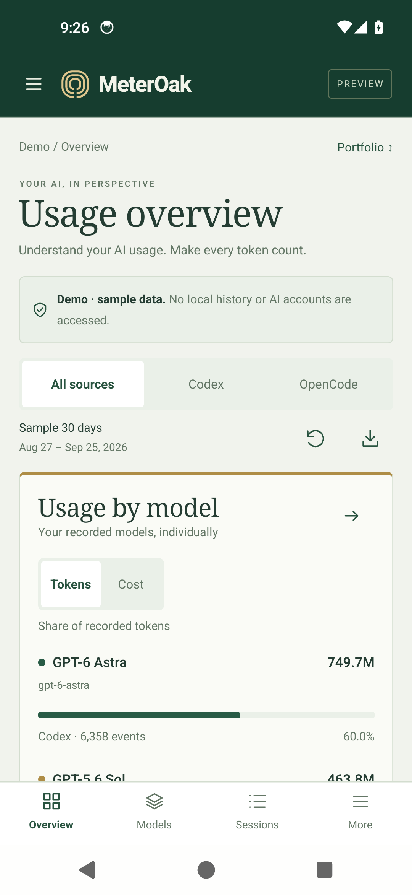

# MeterOak Android

An Android preview of **MeterOak**, an AI usage dashboard for exploring token usage, model breakdowns, and API cost estimates.

[**Download Android APK**](https://github.com/srjay999-giT/MeterOak-Android/releases) · [**Website & main repository**](https://github.com/srjay999-giT/MeterOak)

This preview works offline with bundled sample data. It does not access your AI accounts or local usage history. Cost figures are estimates, not bills.

## Portfolio mode

*Real screenshot of version 0.1.1 running on an Android 14 emulator in the green Portfolio appearance.*

## Install

Download the APK from [Releases](https://github.com/srjay999-giT/MeterOak-Android/releases) and open it on **Android 12 or newer**. Allow installation from your browser or file manager if Android asks.
